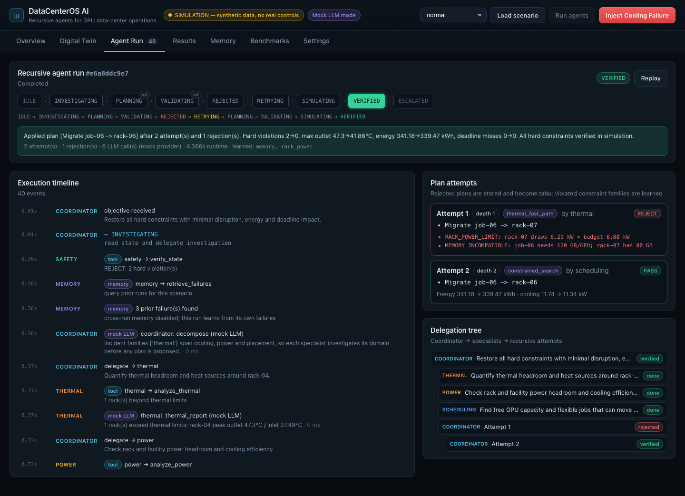

# DataCenterOS AI

**Recursive AI agents that optimize GPU data centers and recover from operational failures.**

Built for the [Crusoe Recursive Agents Hackathon](https://cerebralvalley.ai/e/crusoe-recursive-agents-hackathon), whose theme is "build a team of agents you can walk away from".

> ⚠️ **Simulation only.** Everything runs against a synthetic digital twin. No real infrastructure is controlled, and no value shown is real Crusoe data.

## Deliverables

| | |
|---|---|
| 🎬 Demo video (95 s, recorded from the live app) | [`docs/video/datacenteros-ai-demo.mp4`](docs/video/datacenteros-ai-demo.mp4) |
| 📄 Project guide with page-by-page explanations (Word) | [`docs/DataCenterOS-AI-Project-Guide.docx`](docs/DataCenterOS-AI-Project-Guide.docx) |
| 🖼️ Screenshots of every page | [`docs/screenshots/`](docs/screenshots/) |



## The problem

AI data centers must coordinate GPU workloads, rack power budgets, cooling capacity, temperatures and job deadlines. A *locally reasonable* decision, such as "move the hottest job to the coolest rack", can overload a rack PDU, land a job on GPUs with too little memory, or delay a critical job.

## What it does

A coordinator agent delegates to Thermal, Power and GPU-Scheduling specialists. It proposes a recovery plan and submits it to an **independent deterministic Safety agent**. When the plan is rejected, it **learns** which constraint families were violated and stores the failure in SQLite memory. It then **recursively replans** within a bounded budget (4 attempts by default). If no plan can be verified, it **escalates to a human**.

### The demo (`Inject Cooling Failure`)

1. Rack 04's CRAH loses 30% capacity. In simulation, inlet reaches 27.5 °C and outlet 47.3 °C, violating the 27 °C and 45 °C limits.
2. The Coordinator decomposes the incident. The specialists each run a deterministic analysis tool and an LLM report.
3. **Attempt 1:** the Thermal agent's fast path moves the hottest job (`job-06`, 120 GB/GPU) to the coolest rack (`rack-07`).
4. **The Safety agent REJECTS it** on two counts: `RACK_POWER_LIMIT` (rack-07 would draw 6.29 kW against a 6.0 kW legacy PDU) and `MEMORY_INCOMPATIBLE` (rack-07 has 80 GB GPUs).
5. Memory records the rejection. The plan becomes tabu, and `rack_power` and `memory` join the planner's active constraint set (*lazy constraint generation*).
6. **Attempt 2** (recursion depth 2): the Coordinator chooses a strategy and the optimizer evaluates 14 simulated candidates. It finds `Migrate job-06 → rack-06` (H200, power headroom).
7. The Safety agent returns PASS. The plan is applied to a copy of the twin, re-measured and re-verified, then committed.
8. Result: hard violations 2 → 0, max outlet 47.3 → 41.9 °C, energy 341.2 → 339.5 kWh over 6 h, and no deadline misses.

Every row in the UI timeline is a real tool call, LLM call or state transition, persisted in SQLite and replayable.

## Architecture

```
                 ┌──────────────── Coordinator (LLM: decompose / replan / summarize) ───────────────┐
                 │   state machine: IDLE→INVESTIGATING→PLANNING→VALIDATING→REJECTED→RETRYING→…       │
                 │   budgets: max_attempts, max_depth, max_llm_calls; tabu list; learned families    │
                 └──────┬───────────────┬────────────────┬────────────────┬───────────────┬─────────┘
                        │ delegate      │ delegate       │ delegate       │ verify        │ store/retrieve
                 Thermal agent    Power agent     Scheduling agent   Safety agent     Memory (SQLite)
                 analyze_thermal  analyze_power   analyze_capacity   verify_plan      runs / events /
                 thermal_fast_    estimate_energy plan_search ──►    verify_state     attempts
                 path             _impact         beam-search        (no LLM)
                        └───────────────┴──── deterministic simulator + optimizer (Python) ─────┘
```

* **LLM jobs:** planning/decomposition, choosing the replanning strategy, and specialist and incident summaries. Outputs are JSON, schema-validated, with a deterministic fallback if a call fails or its output is invalid.
* **Deterministic Python handles:** the physics, power, thermal and metric calculations, candidate generation, the optimization objective, every PASS/REJECT, and state transitions.
* **Tool permissions** are enforced per agent (`app/agents/prompts.py`). For example, the thermal agent cannot call `verify_plan`.
* **Strategies** the coordinator can choose: `constrained_search` (migrate/schedule), `defer_flexible`, `power_cap` and `combined`.

### Optimizer

* Beam search: width 30, at most 3 actions per plan.
* Actions: migrate, defer, schedule, and simulated GPU power cap.
* Each candidate is simulated over the full 6 h horizon in 15-minute steps.
* Objective (weights configurable in the UI): energy kWh + thermal-margin² + idle-GPU % + priority-weighted deadline misses + migration cost.
* Hard constraints always override the objective.

### Physical model (documented assumptions — `app/config.py`)

| Quantity | Model |
|---|---|
| GPU power | `0.07 + 0.63 · util · cap` kW (H100-SXM class) |
| Rack IT power | 2.5 kW base + GPUs |
| Outlet temp | `inlet + P_IT / 0.40 kW·°C⁻¹` |
| Inlet temp | `supply + 4 °C · max(0, P_IT − derated cooling capacity)` (recirculation) |
| Cooling power | `min(P, capacity) / COP`, COP 3.5 degrading above 80% load |
| Facility power | IT·(1+4% UPS loss) + cooling + 4 kW misc |
| Power cap throughput | `cap^0.5` (sub-linear) |
| Limits | inlet ≤ 27 °C (ASHRAE A1 recommended), outlet ≤ 45 °C, rack PDU budget, facility 100 kW |

These are plausible simplifications for a hackathon. **They do not prove real-world safety.**

## Benchmarks

Run `cd backend && .venv/bin/python scripts/benchmark.py`. It writes `benchmarks/results.{json,csv}`.

| Scenario | Outcome | Attempts | Rejections | Violations | Energy kWh (6 h) | Plan |
|---|---|---|---|---|---|---|
| normal | VERIFIED | 0 | 0 | 0 → 0 | 338.79 → 338.79 | no action |
| cooling_failure | VERIFIED | 2 | 1 | 2 → 0 | 341.18 → 339.47 | Migrate job-06 → rack-06 |
| power_constraint | VERIFIED | 2 | 1 | 1 → 0 | 338.79 → 336.34 | Cap rack-02 at 80% |
| deadline | VERIFIED | 2 | 1 | 1 → 0 | 338.79 → **349.32** (more work runs) | Migrate job-11 → rack-01; schedule job-16 on rack-07 |
| infeasible | **ESCALATED** | 4 | 4 | 2 → 2 | unchanged | none (human required) |

The deadline fix *increases* energy, because the urgent job actually runs. That is reported, not hidden.

## Run it

Requirements: Python 3.12 (via `uv`) and Node 20+.

```bash
# backend
cd backend
uv venv --python 3.12 .venv && uv pip install --python .venv fastapi 'uvicorn[standard]' httpx pydantic pytest pytest-cov
.venv/bin/uvicorn app.main:app --port 8000

# frontend (new terminal)
cd frontend && npm install && npm run dev      # http://localhost:5173
```

Tests: `cd backend && .venv/bin/python -m pytest --cov=app` (39 tests, 94% coverage).

E2E demo check (both servers running; uses your local Chrome, no npm dependencies): `cd frontend && node e2e/demo.mjs`. It clicks **Inject Cooling Failure**, asserts the REJECT → PASS recovery in the UI, and writes screenshots to `docs/screenshots/`. To re-record the captioned demo video, run `node e2e/record.mjs` (requires ffmpeg).

## Crusoe Managed Inference

The hackathon requires building on Crusoe Managed Inference. The client (`app/agents/llm.py`) uses Crusoe's OpenAI-compatible endpoint:

* **Endpoint:** `https://api.inference.crusoecloud.com/v1/chat/completions`
* **Auth:** Bearer API key, created in the Crusoe console under *Security → Inference API keys*.
* **Behaviour:** JSON-mode requests with a 30 s timeout and 2 retries with backoff. It logs latency and token usage and never logs the key.

```bash
export CRUSOE_API_KEY=...                                   # never commit this
export CRUSOE_MODEL=nvidia/Nemotron-3-Nano-30B-A3B          # optional; verify in your console's model list
cd backend && .venv/bin/uvicorn app.main:app --port 8000
```

Without a key, the app runs a **deterministic mock provider**, and the UI shows "Mock LLM mode". No model inference is claimed in that mode. Set `DCOS_LLM_PROVIDER=mock` to force mock mode even when a key is present.

## API

`GET /api/state` · `POST /api/reset {scenario}` · `POST /api/inject/cooling-failure {rack_id, loss}` · `POST /api/runs` · `GET /api/runs[/{id}]` · `GET|DELETE /api/memory` · `GET|PUT /api/config` · `POST /api/benchmarks` · `GET /api/provider` · `GET /api/assumptions`
